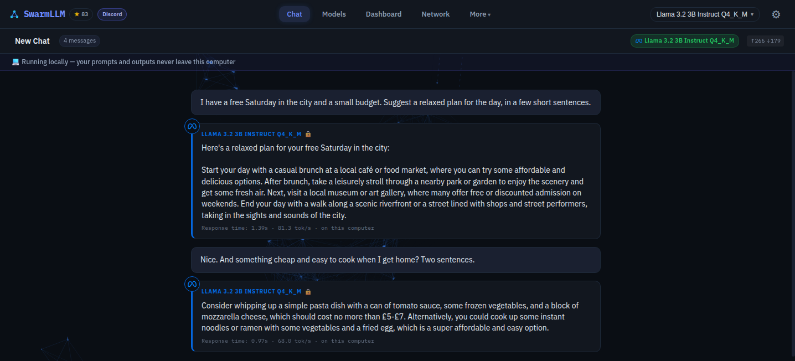
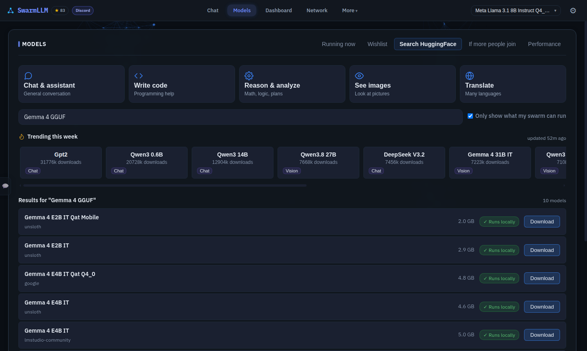
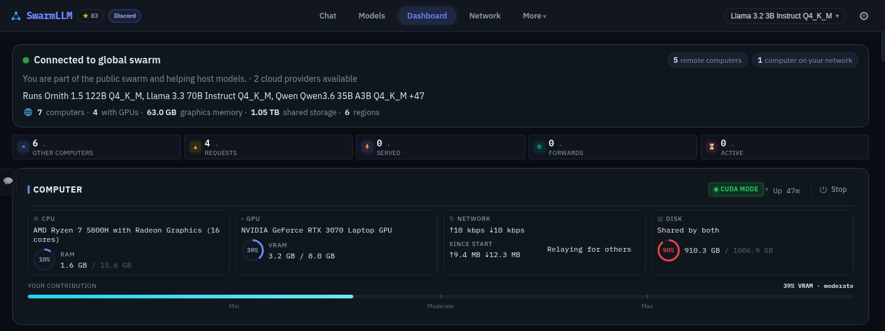
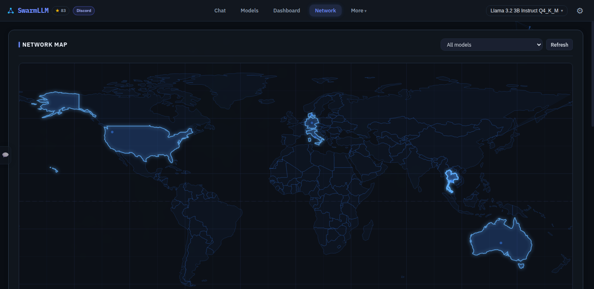

# SwarmLLM

[](https://github.com/enapt/SwarmLLM/releases)
[](https://discord.gg/nq9be3u828)
[](https://github.com/enapt/SwarmLLM)
[](LICENSE-MIT)
[](https://github.com/enapt/SwarmLLM/actions/workflows/ci.yml)
[](https://www.rust-lang.org/)

## Run AI on your own computer. Run bigger AI together.

SwarmLLM is a free app that gives you a ChatGPT-style assistant running on
your own computer, using open AI models from Meta, Google, OpenAI, Alibaba,
Mistral and others. When a model is too big for one machine, computers running
SwarmLLM team up over the internet and run it together, each holding part of
it. Teamed with a computer on another continent, a laptop runs a 14-billion-
parameter model faster than it can alone, and models no home computer can
hold, like Llama 3.3 70B, run across several.

**No account · No subscription · No ads · No crypto · Open source · Updates itself**

**[Download](#get-started)** · **[What people use it for](#what-people-use-it-for)** · **[Join the Discord](https://discord.gg/nq9be3u828)** · **[Get help](#get-help)** · **[For developers](#for-developers)**



> [!IMPORTANT]
> **Keep automatic updates on, or your computer drops off the swarm.** New
> versions come out often, sometimes more than one a day, and **a computer two
> or more releases behind is disconnected until it updates.** Updates are on
> unless you turned them off: **Settings → Software updates** should say
> *Install automatically and restart when idle*. The `.deb`/`.rpm` packages and
> the Docker images can't update themselves — install the new package, or pull
> the new image, when a release comes out.

## Get started

Pick the download for your computer from the
[latest release page](https://github.com/enapt/SwarmLLM/releases/latest):

| Your computer | Download | Runs models on |
|---|---|---|
| Windows with an NVIDIA RTX 30-series card or newer | `swarmllm-windows-x86_64-gpu.zip` | the graphics card and the processor |
| Windows, any other (AMD or Intel graphics, no card, not sure) | `swarmllm-windows-x86_64-cpu.zip` | the processor |
| Mac with an Apple chip (M1 or newer) | `swarmllm-macos-aarch64.tar.gz` | the processor, for now |
| Linux with an NVIDIA RTX 30-series card or newer | `swarmllm-linux-x86_64-cuda.tar.gz` | the graphics card and the processor |
| Linux, any other | `swarmllm-linux-x86_64.tar.gz` | the processor |

Macs with an Intel chip aren't supported yet. A processor from before 2013
needs the download with `-baseline` in its name, which runs on the processor
only.

**Windows**

1. Right-click the downloaded file and choose **Extract All**.
2. Open the extracted folder and double-click **`swarmllm.exe`**. If Windows
   shows a blue box saying *"Windows protected your PC"*, click **More info**,
   then **Run anyway** — it says that about programs from small projects that
   aren't registered with Microsoft yet.
3. A black window with scrolling text appears: that *is* SwarmLLM. **Leave it
   open** (minimising is fine) — closing it switches SwarmLLM off. The app
   opens in your web browser by itself.

**Mac**

1. Double-click the download to unpack it, and keep the folder in
   **Documents** or **Downloads** — not in Applications, where it can't update
   itself.
2. Double-click **`swarmllm`**. macOS blocks the first launch because the app
   isn't registered with Apple yet: open **System Settings → Privacy &
   Security**, click **Open Anyway**, and double-click it again.
3. A Terminal window opens — that's SwarmLLM running, so leave it open. The
   app appears in your web browser.

**Linux** — unpack the download and run `./swarmllm run`.

**Then pick a model and start chatting.** The app shows which models fit your
computer. Your first one is a one-time download of a few gigabytes. If the
browser doesn't open by itself, type `localhost:8800` into its address bar.



**And leave it running, and tell someone near you.** While SwarmLLM is open,
your computer helps the swarm with what it can spare, and every computer nearby
makes bigger models faster for everyone around it —
[here's why](#help-build-the-swarm).

<details>
<summary>Docker or Linux packages?</summary>

The `.deb`/`.rpm` packages (which run as a background service and don't
update themselves) are on the same release page, the Docker images are
`ghcr.io/enapt/swarmllm:latest` (`:latest-cuda` for an NVIDIA card), and
step-by-step help for every system is in the
**[installation guide](https://enapt.github.io/SwarmLLM/getting-started/installation.html)**.

</details>

## What people use it for

- **A private assistant.** Ask about health, money or work with a model that
  runs entirely on your computer: the conversation doesn't leave it, and
  there's no company on the other end. ([Is it private?](#is-it-private))
- **A free coding assistant.** Point Claude Code, Continue, Cline or another
  coding tool at SwarmLLM and use an open coding model, with no per-token bill.
  ([How](#for-developers))
- **Models too big for your computer.** Computers in the swarm each hold part
  of a bigger model and answer together — 27- to 70-billion-parameter models
  that no laptop can hold.
- **One AI for a home, an office or a school.** Computers on the same network
  find each other and team up. Link your own laptop, desktop and home server
  into one group, and **Private Mode** keeps your questions among them and the
  other computers on your network.
- **A use for an older computer.** No graphics card needed: small models run on
  the processor alone, faster than you can read, and a spare computer left on
  adds its room to the swarm.
- **Your own apps, agents and smart home.** Anything that works with OpenAI's
  or Anthropic's API — chat apps, agent frameworks, Home Assistant, OpenClaw —
  can use SwarmLLM instead.
- **Helping others.** While SwarmLLM is open, your computer keeps parts of
  popular models and helps answer other people's questions, like seeding a
  torrent. There's no payment and no token; what you get back is the swarm
  itself: every model it can run, you can use.

The app comes in 21 languages, works on a phone, and shows which model gave
each answer and how long it took.



## How it works

An AI model is built from a stack of layers. SwarmLLM cuts a model into parts,
and each computer in a team holds a few of them. Your question is passed from
one computer to the next like a baton in a relay race — each does its share of
the work, and the answer comes back to you. (If you know BitTorrent: it's that
idea, applied to running AI instead of sharing files.)

```text
   your question ──▶ [ computer A ] ──▶ [ computer B ] ──▶ [ computer C ] ──▶ answer
                       parts 1–10         parts 11–20        parts 21–30
```

- **No central server.** Computers find each other on their own, even behind
  home routers.
- **Nobody has to download the whole model.** Each computer keeps only the
  parts it has room for, within limits you set — or every part, if the model
  fits and you want to run it yourself.
- **Every part is checked.** Model parts are verified when they arrive and
  each time SwarmLLM starts, so a bad copy is caught and replaced.

## How fast is it?

<!-- speeds:begin, reviewed for 0.3.282-alpha. Refreshed at every release: .claude/rules/completeness.md § "README speeds" -->
Speed is in **tokens a second**: a token is a word or part of one, and most
people read about 5 a second. The figures are from the project's test laptop,
with an 8 GB NVIDIA RTX 3070 graphics card and an 8-core AMD Ryzen 7 5800H
processor, on its own or teamed up with volunteers' computers.

<!-- release-check:begin -->
<!-- from the v0.3.281 release check's speed step, timed again on the published release with the machine idle, the check's own figures set aside -->
**On one computer.** Each model reads a 1,800-token document and writes 128
tokens about it.

| Model | Runs on | Writing (tokens a second) | Reading (tokens a second) |
|---|---|---|---|
| Qwen2.5 Coder 7B | the graphics card | 58–61 | 1,810–1,910 |
| Qwen2.5 14B | card and processor (too big for the card) | 16.7–17.8 | 620–630 |
| Qwen3 30B-A3B (2-bit) | card and processor (a mixture of experts, too big for the card) | 23.1–23.7 | 240 |
| Llama 3.2 3B | the processor only | 15.6–15.8 | 80 |
<!-- release-check:end -->

**Across computers.** The same laptop, in Thailand, asking volunteers'
computers: one with a 12 GB RTX 3060 card in Australia, about 130 ms there and
back, and one with a 32 GB RTX 5090 in Denmark, about 210 ms. When a model is
split, a small helper guesses the next few words and the big model checks them
all at once, so each trip across the long link brings back several words.

| Model, and how it is shared | Writing code | Writing prose |
|---|---|---|
| Qwen3.8 27B, run whole by the computer in Denmark | 138–145 | 120–124 |
| Qwen2.5 14B, half on this laptop and half in Australia | 40–43 | 17.8–20.5 |
| The same, set to "Start and finish on this computer" | 27–31 | 12.0–12.8 |
| Qwen3.6 35B-A3B, its first and last layers on this laptop, the middle 38 in Australia | 8.2–18.4 | 7.6–9.5 |
| Llama 3.3 70B, 76 of its 80 layers in Australia, the first two on this laptop and the last two on a small home server beside it | 4.0 | 1.7–1.8 |
<!-- measured on: the two 14B rows and the laptop-alone 14B figures below v0.3.275; the 35B-A3B, 27B and 70B rows v0.3.279 (27B/70B: the live node's own route, ask_tier.py, 160 tokens, code and prose twice each after a warm-up, 11-09) -->

On its own this laptop writes the 14B's code at 14.1–14.5 tokens a second and
its prose at 11.0–11.3, so the two continents together are about three times
as fast on code and 1.6–1.9 times on prose. Code is easier to guess, and the
guesses keep the long link busy ([how](docs/plans/faster_than_local.md)).
<!-- speeds:end -->

## Help build the swarm

How big a model the swarm can run, and how fast, is set by who is online. A
model too big for one computer answers fastest when the computers holding it
are **near each other**, because every word of the reply passes through all of
them. Computers on different continents work together too, but nearby is
faster.

So the swarm needs **more computers, and enough of them close together.** No
amount of code can do that part — only people can.



- **Install it, leave it running, and bring someone near you** — a friend
  across town, a housemate, your office. They don't need to set anything up:
  they install it too, and the computers find each other.
- **[Find people near you on Discord](https://discord.gg/nq9be3u828)** and
  team up.
- **Star this page** so others can find it.

Computers near each other already share out a big model's parts and run it
together on their own, and where there aren't enough of them nearby, the swarm
teams up computers further away.

## Is it private?

It depends on where the model runs, so here's the straight answer:

- **On your own computer — yes.** When a model runs entirely on your machine,
  your conversation doesn't leave it.
- **In the public swarm — only partly.** Connections between computers are
  encrypted, so nobody watching the internet can read them. But the computers
  doing the work for you do see what they're working on, and a determined
  person running one of them could reconstruct your question. **Don't send
  anything sensitive through the public swarm.**
- **Start and finish on this computer — harder to read, still not private.**
  When your computer holds a model's first and last parts, you can have it do
  the first and last steps itself (switch it on per model on the model's card
  on the Dashboard; it is off unless you do, so replies take the fastest
  route). Other computers then never receive your typed text or the reply —
  only the numbers in between. Those numbers can still reveal much of
  what you wrote, so it is a real improvement but not a guarantee, and replies
  get slower.
- **Private Mode** keeps your questions on your own linked devices and, by
  default, on other SwarmLLM computers it treats as local: any on your network,
  or any that answer in under about 2.5 milliseconds. In a shared building or on a fast
  city network that can include strangers — `private_mode_allow_lan = false` in
  the config file turns that part off. Your computer still helps others with
  what it can spare. Switch Private Mode on under **More → My Devices** in the
  app.

The model list in the app shows which models are **on this computer**. The
details are in the
[security guide](https://enapt.github.io/SwarmLLM/architecture/security.html).

## Get help

**The common first-run problems:**

- **The browser didn't open.** With SwarmLLM's window open, go to
  `localhost:8800` in your browser.
- **Windows or macOS won't start it.** Both warn about apps that aren't
  registered with Microsoft or Apple yet; [Get started](#get-started) shows the
  one-time click past it.
- **It closes straight away with *Illegal instruction*.** Your processor is
  from before 2013: take the download with `-baseline` in its name.
- **It doesn't use my graphics card.** It needs an NVIDIA RTX 30-series card or
  newer and, on Windows, the `-gpu` download. Any other card leaves the work to
  the processor.
- **No other computers show up, a download is stuck, or a model is slow.** The
  [troubleshooting guide](https://enapt.github.io/SwarmLLM/troubleshooting.html)
  goes through each.

**Still stuck?** Ask on **[Discord](https://discord.gg/nq9be3u828)** or open an
**[issue](https://github.com/enapt/SwarmLLM/issues)**, and paste the report
from **Settings → Testing & Diagnostics → Copy diagnostics** (or run
`swarmllm diagnostics`). It is safe to post in public: no keys, no invite
codes, and network addresses are replaced with placeholders.
[What else helps](docs/TESTING.md). Ideas and questions go in
**[Discussions](https://github.com/enapt/SwarmLLM/discussions)**; please report
security problems privately ([SECURITY.md](SECURITY.md)).

## Common questions

**What's the catch?** There's nothing to buy — no account, no ads, no
cryptocurrency. The only cost is your own electricity and internet while your
computer helps others. It's a community project: the app is free and open
source, and the computing power comes from people who leave it running.

**Can someone use the swarm without helping?** Not for long. Other computers
run your chats only while yours shares at least two parts of a model — leave
auto-manage on and that happens by itself — and only while it stays up to date.
A computer that shares nothing can still see the swarm, and still run the
models it holds itself. The list of computers on the Dashboard shows, for each
one, how many chats it ran for yours and how many yours ran for it, so anyone
can see a computer that only takes. Those counts are what your own computer
saw, and nothing is charged or paid by them.

**How is this different from Ollama or LM Studio?** They run AI on one
computer, and they're great at it. SwarmLLM does that too — and also lets
computers pool together, your own devices or the public swarm, to run models
one machine can't hold. ([How it compares with Petals, exo and
others](https://enapt.github.io/SwarmLLM/comparison.html).)

**What do I need?** A Windows, Linux or Apple-chip Mac computer, ideally with
8 GB of memory or more, and a few gigabytes of free disk space per model. A
graphics card makes it much faster but isn't required; the table in
[Get started](#get-started) shows which ones it uses. A Mac runs models on the
processor for now — slower than a PC with a gaming card, but a MacBook Air runs
the smaller models.

**Will it slow my computer down?** It can, while it's answering someone.
SwarmLLM keeps a slice of your graphics card free and fits around whatever
memory other programs are already using, but it doesn't know when you're
gaming or busy. If something feels slower, close the SwarmLLM window while
you play, pick a lighter contribution level in Settings, or set a
**Resource Schedule** so it holds back at the times you choose. The download
from the release page runs only while its window is open; the `.deb`/`.rpm`
packages install it as a background service, which starts with the computer
once you enable it.

**How much internet does it use?** Left running with nothing to do, connected
to six other computers, **under 10 MB an hour each way** — what keeps it in
touch with the swarm. It uses more while it shares model parts or works for
others, and nothing while it is closed. In Settings you can cap how fast it
shares parts, and on a connection your computer marks as metered (like a
phone's hotspot) it pauses its own downloads and its work for others — or you
can tell it to pause them always.
<!-- idle traffic measured on v0.3.279: total less parts, inference and relay, 10-min samples 15-85 min after a start, six computers connected: in 7.4-11.4, out 6.4-8.4 MB/h, 9.1 / 7.3 overall -->

**How much disk space?** SwarmLLM keeps what it stores within a disk limit —
50 GB by default — which you can change in Settings. Whatever the limit, it
always leaves at least a tenth of your disk free.

**Is it a virus?** No. Every line of the program is public for anyone to
inspect, and SwarmLLM's automatic updates only install releases signed by the
project. Windows and macOS warn you the first time only because the app isn't
registered with Microsoft or Apple yet — common for small free projects. Other
computers in the swarm can never run programs on yours: they only exchange
parts of AI models and the numbers the AI works with.

**How do I remove it?** Close the SwarmLLM window, then delete the folder you
unpacked and the folder where it keeps models: `%APPDATA%\swarmllm` on Windows,
`~/Library/Application Support/swarmllm` on a Mac, `~/.local/share/swarmllm`
on Linux.

**Which models can I run?** Popular open models — Llama, Qwen, Gemma, gpt-oss,
Mistral, Phi, GLM and more, from small ones that run on a laptop up to a
70-billion-parameter Llama shared across the swarm. The app shows which ones
your computer, or the swarm, can actually run.

## For developers

*(You can skip this part if you just want to chat.)*

**A free OpenAI- and Anthropic-compatible endpoint on your own machine.** Point
any agent, coding assistant or chat app at `http://localhost:8800` — no
per-token bill, and models bigger than your machine behind the same URL. Copy
your key from **Settings → Access Token** in the app:

```bash
export SWARMLLM_KEY=...   # from Settings → Access Token

curl http://localhost:8800/v1/chat/completions \
  -H "Authorization: Bearer $SWARMLLM_KEY" \
  -H "Content-Type: application/json" \
  -d '{"model": "llama-3.2-3b-instruct-q4-k-m",
       "messages": [{"role": "user", "content": "Hello!"}]}'
```

As a Claude Code backend:

```bash
ANTHROPIC_BASE_URL=http://localhost:8800 ANTHROPIC_AUTH_TOKEN="$SWARMLLM_KEY" \
  claude --model qwen2.5-coder-7b-instruct-q4-k-m
```

**Works with the tools you already use.** Any app that takes an
OpenAI-compatible address — for example Open WebUI, LibreChat, Continue, Cline
or Home Assistant — can use SwarmLLM: give it `http://localhost:8800/v1` and
the key. Anthropic clients like Claude Code take `http://localhost:8800`, as
above.

Also included: tool calling with local models, streaming, an MCP server, and
optional routing to 12 cloud providers with your own keys. Agents send long
prompts, so raise the context size first (`max_seq_len_override = 32768`
under `[inference]` in `config.toml`). That setting covers the parts of a model
your computer runs; a part running on another computer follows that computer's
own setting, and the swarm routes around one that is set too short.

- **[API reference](https://enapt.github.io/SwarmLLM/api/openai.html)** — OpenAI, Anthropic, Responses and MCP
- **[Claude Code](https://enapt.github.io/SwarmLLM/api/anthropic.html)**, **[OpenClaw](integrations/openclaw/)** (a plugin that adds SwarmLLM to OpenClaw's setup wizard) and **[Continue, Cursor and other MCP clients](https://enapt.github.io/SwarmLLM/api/mcp.html)** — setup notes
- **[Configuration](https://enapt.github.io/SwarmLLM/configuration/reference.html)** and **[command line](https://enapt.github.io/SwarmLLM/configuration/cli-env.html)**
- **[Architecture](docs/ARCHITECTURE.md)** ([every document, one page](docs/README.md)), **[performance](https://enapt.github.io/SwarmLLM/operations/performance.html)** and **[how it compares](https://enapt.github.io/SwarmLLM/comparison.html)**

To build it yourself:

```bash
# Requires Rust 1.90+
git clone https://github.com/enapt/SwarmLLM.git && cd SwarmLLM
cargo build --release
```

GPU builds — the build command for each release variant — are in [CONTRIBUTING.md](CONTRIBUTING.md).
**[Contributing](CONTRIBUTING.md)** covers building, testing and sending a pull
request; the **[changelog](CHANGELOG.md)** says what changed recently.

## Built in the open

SwarmLLM is built by a human developer working with Claude Code, an AI
programming assistant: the human sets the direction, tests and reviews, and
Claude writes the code. We say so openly so you can judge the project on its
merits. Every change is checked by thousands of automated tests
(4529 lib tests + 80 integration tests) before it ships, and regular
automated audits are logged in the repository. Scrutiny and contributions are
welcome.

## License

Dual-licensed under [MIT](LICENSE-MIT) and [Apache 2.0](LICENSE-APACHE).
